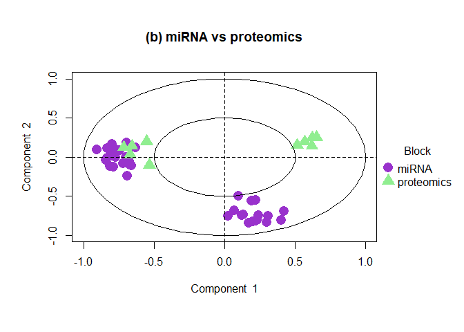
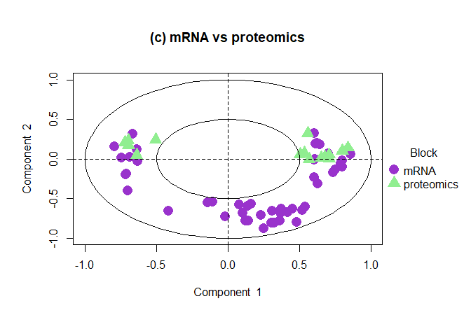

# Case Study of DIABLO with Breast TCGA Dataset - MixOmics Tutorial


- [Overview](#overview)
- [KNOWLEDGE HINT: What is DIABLO?](#knowledge-hint-what-is-diablo)
- [Case Study of DIABLO with Breast TCGA
  Dataset](#case-study-of-diablo-with-breast-tcga-dataset)
  - [To Begin](#to-begin)
  - [The Data](#the-data)
  - [Initial Analysis](#initial-analysis)
    - [Pairwise PLS (Projection of Latent Structures)
      Comparisons](#pairwise-pls-projection-of-latent-structures-comparisons)
  - [Initial DIABLO Model](#initial-diablo-model)
    - [Design](#design)
    - [Tuning the number of components
      (perf())](#tuning-the-number-of-components-perf)

## Overview

This case study shows how to use DIABLO to integrate mRNA, miRNA, and
proteomics data from breast cancer patients. DIABLO helps identify a
multi-omics signature that discriminates cancer subtypes (Basal, Her2,
and LumA) by finding correlated and predictive features across datasets.
You’ll learn how to tune the model, explore the relationships between
features, and interpret sample groupings.

## KNOWLEDGE HINT: What is DIABLO?

    PENDING To complete https://mixomics.org/mixdiablo/

# Case Study of DIABLO with Breast TCGA Dataset

The aim of this N-integration analysis is to identify a highly
correlated multi-omics signature that discriminates the breast cancer
subtypes Basal, Her2 and LumA.

## To Begin

Note that the seed is set such that all plots can be reproduced. This
should not be included in proper use of these functions.

``` r
library(mixOmics) # import the mixOmics library
set.seed(123)  # for reproducibility, remove for normal use
```

## The Data

Human breast cancer is a heterogeneous disease in terms of molecular
alterations, cellular composition, and clinical outcome. Breast tumours
can be classified into several subtypes, according to levels of mRNA
expression (Sørlie et al., 2001 \[1\]).

Here we consider a subset of data generated by The Cancer Genome Atlas
Network (Network et al., 2012 \[2\]). Data were normalized and
drastically pre-filtered for illustrative purposes.

The data were divided into a training set with a subset of *150 samples*
from the *mRNA, miRNA and proteomics data*, and a *test set* includes
*70 samples, but only from the mRNA, miRNA and methylation data
(proteomics missing)*.

The mixOmics TCGA dataset is accessed via \`breast.TCGA’ and contains
the following:

- breast.TCGA$data.train$mirna (continuous matrix): 150 rows and 184
  columns. The expression levels of *184* different sections of miRNA.
- breast.TCGA$data.train$mrna (continuous matrix): 150 rows and 200
  columns. The expression levels of *200* different sections of mRNA.
- breast.TCGA$data.train$protein (continuous matrix): 150 rows and 142
  columns. The abundance of *142* different proteins
- breast.TCGA$data.train$subtype (categorical vector): length of *150*.
  Indicates the breast cancer subtype of each subject. Includes *Basal,
  Her2 and LumA*.

To confirm the correct dataframes were extracted, the dimensions are
checked. The distribution of class labels is also examined. It can be
seen that these class labels are not balanced. Note that the dataframes
in the data list should be named.

``` r
data(breast.TCGA) # load in the data

# set a list of all the X dataframes
data = list(miRNA = breast.TCGA$data.train$mirna, 
            mRNA = breast.TCGA$data.train$mrna,
            proteomics = breast.TCGA$data.train$protein)

lapply(data, dim) # check their dimensions
```

    $miRNA
    [1] 150 184

    $mRNA
    [1] 150 200

    $proteomics
    [1] 150 142

``` r
Y = breast.TCGA$data.train$subtype # set the response variable as the Y df
summary(Y)
```

    Basal  Her2  LumA 
       45    30    75 

We have 150 samples in each dataset, and Y label -\> 45 + 30 + 75 = 150

## Initial Analysis

### Pairwise PLS (Projection of Latent Structures) Comparisons

It is strongly advised that prior to using the DIABLO framework that the
data be examinsed in a non-integrative context.

- PLS = Projection of Latent Structures or Partial Least Squares) -\> it
  searches for hidden patterns also known as components.

We want to know which variable from dataset A changes simultaneously as
variable fromdataset B.

- sPLS = sparse PLS -\> the s means we are aplying a selection filter,
  instead of considering the whole bunch of genes. We select the “best”
  variables using lasso penalization

``` r
list.keepX = c(25, 25) # select arbitrary values of features to keep
list.keepY = c(25, 25)

# generate three pairwise PLS models
pls1 <- spls(data[["miRNA"]], data[["mRNA"]], 
             keepX = list.keepX, keepY = list.keepY) 
pls2 <- spls(data[["miRNA"]], data[["proteomics"]], 
             keepX = list.keepX, keepY = list.keepY)
pls3 <- spls(data[["mRNA"]], data[["proteomics"]], 
             keepX = list.keepX, keepY = list.keepY)
```

#### Visualization

We’ll use a **Circle Correlation Plot** -\> we should interpret them as
a “radar” or “target”. Every dot corresponds to a concrete variable. The
closer we see the dots to the external circle (1.0) the stronger is its
correlation.

When we set a cutoff in 0.5 we are telling the plot not to dorw any dot
inside that inner circle (we don’t want to see variables with a poor
correlation).

- Points on the same position = positive correlation
- Points on opposite position = negative correlation
- 90º relationship between points (one up, one right) = no correlation

If we see that the variables are close to the left or right, we might
say there is a strong correlation with component 1.

Visualize variable correlation with a cutoff of 0.5:

``` r
plotVar(pls1, cutoff = 0.5, title = "(a) miRNA vs mRNA",
        legend = c("miRNA", "mRNA"), var.names = FALSE, style = "graphics",
        pch = c(16, 17), cex = c(2, 2), col = c("darkorchid", "lightgreen"))
```


``` r
plotVar(pls2, cutoff = 0.5, title = "(b) miRNA vs proteomics",
        legend = c("miRNA", "proteomics"), var.names = FALSE, style = "graphics",
        pch = c(16, 17), cex = c(2, 2), col = c("darkorchid", "lightgreen"))
```



``` r
plotVar(pls3, cutoff = 0.5, title = "(c) mRNA vs proteomics",
        legend = c("mRNA", "proteomics"), var.names = FALSE, style = "graphics",
        pch = c(16, 17), cex = c(2, 2), col = c("darkorchid", "lightgreen"))
```



The strong correlation between a large portion of the miRNA and mRNA
features along the first component and to a slightly lesser extent on
the second component is depicted in (a). Some of the features in (b)
have very strong clustering while other do not, suggesting that some
features of the mRNA and protein dataframes are highly correlated. The
mRNA and protein features in (c) are the most weakly clustered but are
the most strongly correlated along the first component specifically.

Below is are correlations between the first component of each dataset
for all three PLS models. It can be seen the values are around ~0.8 -
0.9.

*Extended revision*

- 1)  -\> on the left, a bunch of high correlated variables among both
      omics. On the right, a negative correlation with a group of
      triangles.
- 2)  -\> strong correlation on the group of the left. The miRNA on the
      botton are not correlated with the rest.
- 3)  -\> variables are more dispersed, but they are well positionated
      for component 1.

Below is are correlations between the first component of each dataset
for all three PLS models. It can be seen the values are around ~0.8 -
0.9.

``` r
# calculate correlation of miRNA and mRNA
cor(pls1$variates$X, pls1$variates$Y) 
```

               comp1         comp2
    comp1 0.88417918 -1.511654e-16
    comp2 0.04929884  7.425733e-01

``` r
# calculate correlation of miRNA and proteins
cor(pls2$variates$X, pls2$variates$Y) 
```

               comp1        comp2
    comp1 0.83619934 6.187928e-17
    comp2 0.02358213 5.626135e-01

``` r
# calculate correlation of mRNA and proteins
cor(pls3$variates$X, pls3$variates$Y) 
```

               comp1         comp2
    comp1  0.9360264 -1.751515e-17
    comp2 -0.0181090  5.972544e-01

## Initial DIABLO Model

### Design

The moderate to high correlation between these features means that an
appropriate value for the design matrix would be about ~0.8 - 0.9.
However, as discussed in the N-Integration Methods page, values above
0.5 will cause a reduction in predictive ability of the model - and
prediction is what is desired in this context. Hence, a value of 0.1
will be used to prioritise the discriminative ability of the model.

        *Extended explanation*

        Think of the design matrix as a set of instructions telling DIABLO how strongly you want it to link your different omics datasets together.
        It is a simple grid where every row and column is one of your omics (miRNA, mRNA, proteomics). Each number inside the grid goes from 0 to 1:

        - A value of 0 = "Ignore whether these two omics correlate with each other."
        - A value of 1 = "Force these two omics to correlate as strongly as possible."

        The diagonal will be 0 beacuse a dataset does not need to be linked to itself.

        Why use 0.1 instead of 0.8 - 0.9? -> DIABLO is trying to do two jobs at the same time:

                - Find correlations between your omics (miRNA, mRNA, and proteomics).
                - Predict the outcome Y (for example, accurately separating different breast cancer subtypes).

        Based on the previous pairwise PLS plots, the omics are naturally very correlated (around 0.8 - 0.9). We might think we should put 0.8 in the design matrix to match that. However, if we put a high value (above 0.5), DIABLO becomes obsessed with making the omics agree with each other, and it loses accuracy when predicting Y.
        Since prediction (discriminative ability) is the main goal here, the authors choose 0.1. This tells the model: "Focus mainly on separating the patient groups (Y) accurately, while still giving a gentle nudge to keep the omics correlated."

``` r
# for square matrix filled with 0.1s
design = matrix(0.1, ncol = length(data), nrow = length(data), 
                dimnames = list(names(data), names(data)))
diag(design) = 0 # set diagonal (miRNA-miRNA, mRNA-mRNA, etc.) to 0s

design
```

               miRNA mRNA proteomics
    miRNA        0.0  0.1        0.1
    mRNA         0.1  0.0        0.1
    proteomics   0.1  0.1        0.0

With a design in place, the initial DIABLO model can be generated. An
arbitrarily high number of components (ncomp = 5) will be used. Because
at this stage, you don’t know yet how many components you actually need.
You start with a generous number like 5 so that in the very next step
(using the perf() function), you can evaluate components 1 through 5 and
see where the model’s prediction error stops improving.

``` r
# form basic DIABLO model
basic.diablo.model = block.splsda(X = data, Y = Y, ncomp = 5, design = design) 
```

With all of these, we have created the initial model, now we should
evaluate and tune the number of components and variables. THis process
can be called hyperparameter tuning.

### Tuning the number of components (perf())

In the previous step, we built a basic model with ncomp = 5. Now we test
whether we actually need all 5 components, or if 2 or 3 is enough. To
choose the number of components for the final DIABLO model, the function
perf() is run with 10-fold cross-validation repeated 10 times.

``` r
# run component number tuning with repeated CV
perf.diablo = perf(basic.diablo.model, validation = 'Mfold', 
                   folds = 10, nrepeat = 10) 
```

        What is 10-fold CV repeated 10 times?
        Imagine splitting your patients into 10 equal groups ("folds"). The model trains on 9 groups and tries to predict the cancer subtype of the 10th group. It repeats this so every group gets tested once. Doing nrepeat = 10 shuffles the patients and repeats the whole process 10 times so your results aren't just a lucky split.

How to interpret that plot?

    Concepts explanation: 
       
       *Overall Error Rate (Overall.ER) vs. Balanced Error Rate (Overall.BER):*
                - ER is just the total percentage of patients misclassified.
                - BER calculates the error rate for each cancer subtype separately and averages them. Hint: Always prefer BER when your groups have different sizes (e.g., 100 patients of Subtype A and only 20 of Subtype B), otherwise the model can cheat by just guessing the biggest group. 

        *What are the 3 distances (max.dist, centroids.dist, mahalanobis.dist)?*
        When DIABLO (or PLS-DA) predicts which group a new patient belongs to, it needs a rule to turn the model's numbers into a final class label (e.g., Subtype A, Subtype B, or Subtype C). The three distances are simply three different rules for making that decision:
                - max.dist (Maximum Distance) -> This is the simplest rule. 
                        - For every new patient, the model outputs a predicted score for each group (for example: Subtype A = 0.75, Subtype B = 0.20, Subtype C = 0.05). max.dist literally just picks the group with the highest score. 
                        - Intuition: "Whichever group gets the highest vote wins."
                        - Best for: Clean datasets where the groups are clearly separated and don't overlap much.
                - centroids.dist (Centroids Distance)
                        - The model finds the exact center (average point) of each group in the component space. When a new patient arrives, it measures the straight-line (Euclidean) distance from that patient to each group's center and assigns them to the closest center.
                        - Intuition: "Measure with a ruler to the middle of each cluster; whichever middle is closest wins."
                        - Best for: A reliable, well-rounded choice when groups form roughly circular clouds, even if there is some overlap.
                - mahalanobis.dist (Mahalanobis Distance)
                        - Like centroids.dist, it measures the distance to each group's center—but it also accounts for the size, spread, and shape of each group
                        - Intuition: Imagine Group A is a tiny, tight circle and Group B is a huge, stretched-out oval. A new patient might be slightly closer in straight-line distance to Group A's center, yet still be sitting right inside the stretched-out cloud of Group B. A normal ruler (centroids.dist) would pick Group A, whereas mahalanobis.dist understands the shape of the clouds and correctly assigns the patient to Group B.
                        - Best for: Complex datasets where one group is much more variable/spread out than another, or where clusters are elongated ovals rather than neat circles.

Choose the distance that gives the lowest error rate with the fewest
components:

``` r
plot(perf.diablo) # plot output of tuning
```


From the performance plot above, we observe that both overall and
balanced error rate (BER) decrease from 1 to 2 components. The standard
deviation indicates a potential slight gain in adding more components.
The centroids.dist distance seems to give the best accuracy (see
Supplemental Material in \[6\]). Considering this distance and the BER,
the output \$choice.ncomp indicates the optimal number of components for
the final DIABLO model.

``` r
# set the optimal ncomp value
ncomp = perf.diablo$choice.ncomp$WeightedVote["Overall.BER", "centroids.dist"] 
# show the optimal choice for ncomp for each dist metric
perf.diablo$choice.ncomp$WeightedVote 
```

                max.dist centroids.dist mahalanobis.dist
    Overall.ER         3              3                3
    Overall.BER        3              3                3

What is WeightedVote?

Since you have 3 omics (miRNA, mRNA, proteomics), each omic “votes” on
which subtype a patient belongs to. WeightedVote gives more voting power
to the omics that are better at predicting Y. Looking at Overall.BER and
centroids.dist, the optimal number of components is 2. Adding components
3, 4, or 5 doesn’t meaningfully reduce the error—it just adds noise.
